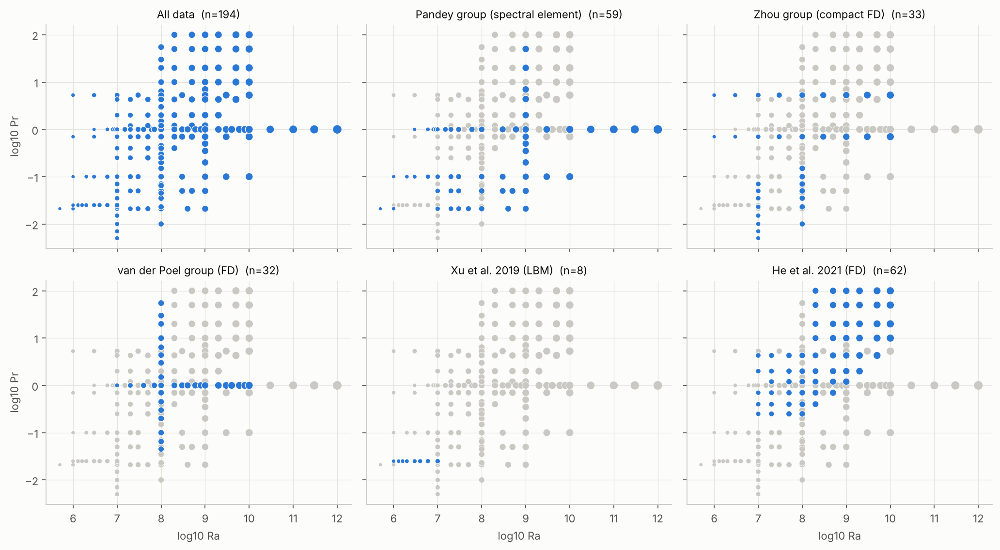
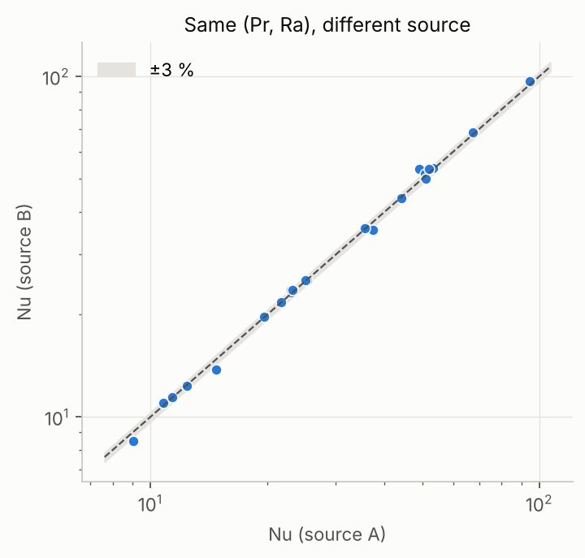
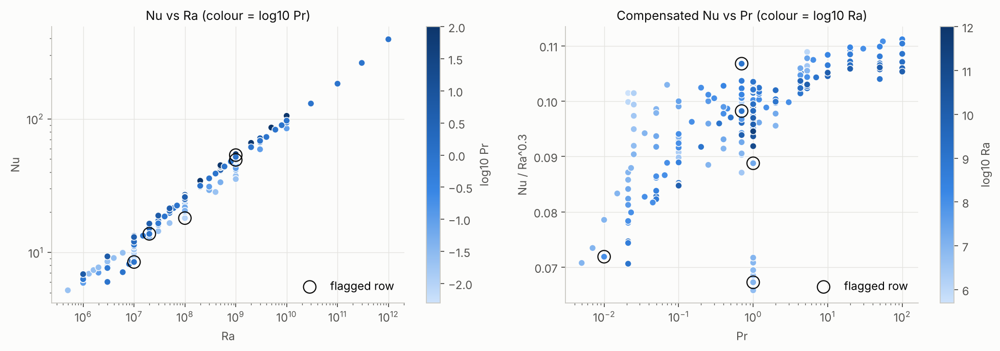
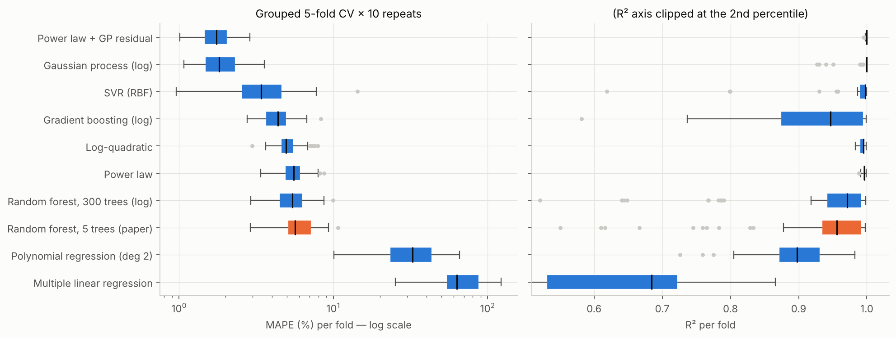
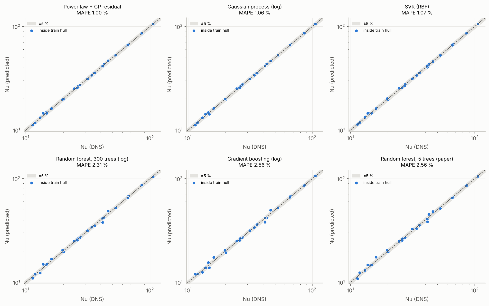
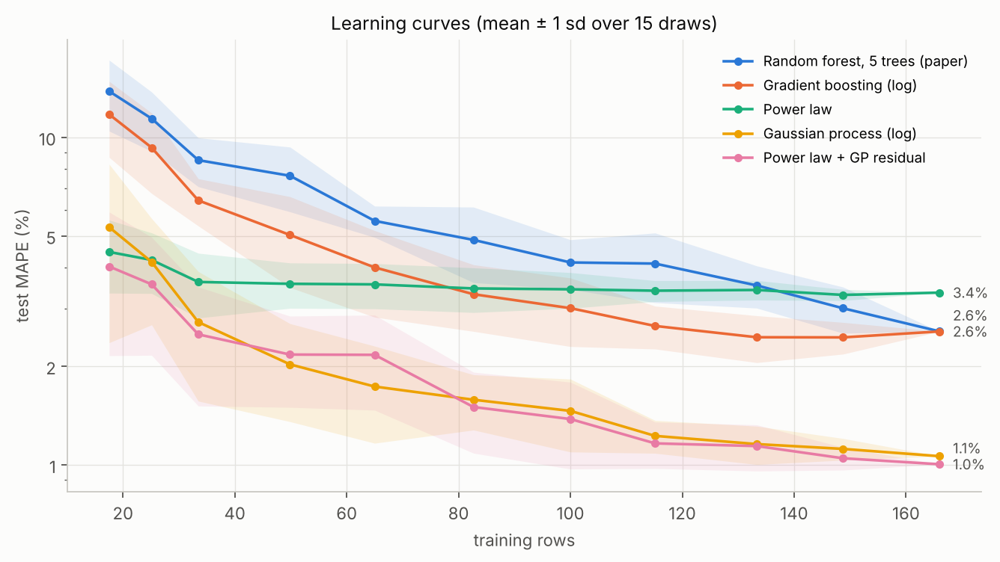
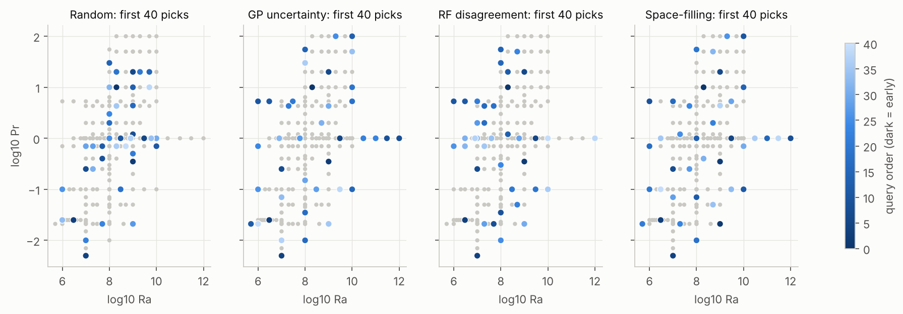
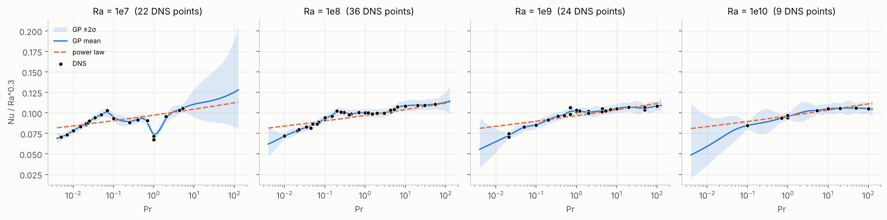

# rayleigh-benard

Machine-learning prediction of the Nusselt number (Nu) from the Prandtl (Pr)
and Rayleigh (Ra) numbers in 2D Rayleigh-Bénard convection. The starting point
is Sec. 3.3 ("Forecasting heat transport using machine learning") of
Shreshthi & Pandey, which trains a 5-tree random forest on 55 DNS points. This
repo extends that work in four ways:

1. **More data.** 59 → 194 rows, pooled from 10 papers that simulate exactly
   the same setup, with full provenance.
2. **Honest evaluation.** Grouped train/val/test splits and grouped
   cross-validation, so the same (Pr, Ra) point never sits on both sides.
3. **Better models.** Physics-informed (power law) and probabilistic
   (Gaussian process) models alongside the paper's methods.
4. **New questions.** How much data is enough (learning curves), which
   simulations to run next (active learning), and how far each model can be
   trusted outside its data (extrapolation tests).

**Headline:** a power-law mean with a Gaussian-process correction predicts Nu
to **1.8 %** mean error under grouped cross-validation, against **6.0 %** for
the paper's random forest. It also stays at about 2 % when asked to
extrapolate three decades in Ra, where the random forest misses by 39 %.
Choosing new simulations where the GP is most uncertain reaches 3 % mean
error with about **40 DNS runs instead of 84** picked at random.

---

## 1. The data

All rows describe one physical setup: a closed 2D square box (aspect ratio
Γ = 1), no-slip on every wall, isothermal top and bottom plates, adiabatic
sidewalls.

| Source | Rows | How the values were obtained |
|---|---|---|
| Shreshthi & Pandey (2026), Pandey (2021), Pandey & Sreenivasan (2025), Pandey, Tiwari & Sreenivasan (2026) | 59 | tables (the original dataset) |
| He et al. (2021) | 62 | extracted from the vector graphics of Fig. 5(a) |
| Zhang, Zhou & Sun (2017) | 18 | table |
| van der Poel, Stevens & Lohse (2013) | 16 | appendix table |
| van der Poel et al. (2012) | 16 | extracted from the vector graphics of Fig. 1(a) |
| Zhang & Zhou (2024) | 15 | table |
| Xu, Shi & Xi (2019) | 8 | table |

| | min | max |
|---|---|---|
| Pr | 0.005 | 100 |
| Ra | 5×10⁵ | 10¹² |
| Nu | 5.2 | 394.2 |

**Where the data sit.** Each panel highlights one group of codes against
the rest (grey). The new sources fill in what the original 59 rows lacked:
He et al. cover high Pr, the Zhou group low Pr, van der Poel the Pr = 1 line
and an Ra = 10⁸ Pr-sweep.



**Can data from different codes be pooled?** At the 20 (Pr, Ra) points
simulated by more than one paper, with different numerical methods (spectral
element, three finite-difference codes, lattice Boltzmann), Nu agrees to a
median of 1.5 %, nearly all within ±3 %. That is the evidence that the pooled
data are consistent.



**What the physics looks like.** Left: Nu rises with Ra as a near power law.
Right: dividing by Ra^0.3 exposes the Pr dependence. Nu grows with Pr at low
Pr and flattens above Pr ≈ 1. The scatter at fixed Pr is real physics: 2D
convection can settle into different roll states with different Nu. Circled
rows are flagged in the data file (e.g. Pr = 0.7, Ra = 10⁹, where two papers
report 49.2 and 53.5, both correct).



Files: [`data/nu_dataset_model.csv`](data/nu_dataset_model.csv) (Pr, Ra, Nu;
load this for training) and
[`data/nu_dataset_sources.csv`](data/nu_dataset_sources.csv) (same rows plus
Source, Grid, Notes, Flag). Every source table, every kept and excluded row,
and the figure-extraction method are in
**[`docs/data_sources.pdf`](docs/data_sources.pdf)**.

Left out on purpose: resolution-check re-runs, exact duplicates, periodic
("RBC-P") domains, other aspect ratios, and Yang et al. (2021), whose values
exist only in a low-resolution raster figure.

## 2. Train / validation / test split

The split is **grouped** 70/15/15: all rows with the same (Pr, Ra) go to the
same side, so a model cannot be tested on a point it effectively saw.

| Split | Rows | Pr | Ra | Nu (median) | Inside training range |
|---|---|---|---|---|---|
| train | 138 | 0.005 – 100 | 10⁶ – 10¹² | 5.91 – 394.2 (25.2) | — |
| val | 28 | 0.021 – 50 | 5×10⁵ – 3×10¹¹ | 5.2 – 262.3 (26.8) | 96 % |
| test | 28 | 0.023 – 100 | 10⁷ – 10¹⁰ | 11.4 – 105.9 (29.4) | 100 % |
| all | 194 | 0.005 – 100 | 5×10⁵ – 10¹² | 5.2 – 394.2 (25.3) | |


Every test point lies inside the training data's convex hull, so the test
score below measures *interpolation*. Sections 3 and 6 give the more demanding
numbers.

## 3. Which model works best

Ten methods: the four the paper tried (linear, polynomial, SVR, random
forest), stronger tree ensembles, a power law `Nu = C·Ra^a·Pr^b`, a
log-quadratic fit, a Gaussian process (GP) on log Nu, and a **power law + GP
residual** model (the power law supplies the trend, the GP corrects what it
misses). Hyperparameters are tuned on validation.

**Repeated grouped 5-fold cross-validation** (all data, 10 reshuffles):
the paper's random forest is shown in orange. MAPE = mean relative error.



| Method | MAPE % (grouped CV) | Test-set MAPE % |
|---|---|---|
| **Power law + GP residual** | **1.8** | 1.0 |
| Gaussian process on log Nu | 1.9 | 1.1 |
| SVR | 3.9 | 1.1 |
| Gradient boosting (log target) | 4.4 | 2.6 |
| Log-quadratic | 5.3 | 3.7 |
| Power law `Nu = 0.0999·Ra^0.298·Pr^0.031` | 5.6 | 3.4 |
| Random forest, 300 trees | 5.6 | 2.3 |
| Random forest, 5 trees (**paper's method**) | 6.0 | 2.6 |
| Polynomial regression (deg 2) | 34 | 21 |
| Multiple linear regression | 67 | 31 |

**Test-set parity** for the top methods (grey band = ±5 %):



The fitted Ra exponent, 0.298, matches the Nu ~ Ra^0.3 scaling usual for 2D
convection in this range.

## 4. How much data is enough (learning curves)

Test error vs. number of training rows (15 random draws per size). The two GP
models reach about 2 % with 50–65 rows and keep improving to about 1 %. The
power-law models are far ahead when data are scarce (about 4 % with
18 rows, against 11–13 % for the tree models), but the plain power law
plateaus at about 3.4 %, because a single power law is too rigid. The paper's
random forest needs the full dataset to get to 2.6 %, and its curve is still
falling, so it is data-hungry rather than broken.



## 5. Which simulation to run next (active learning)

Start from 8 known points and add 2 at a time, chosen by one of four rules:
at random, where the GP is most uncertain, where the random forest's trees
disagree most, or where the (Pr, Ra) plane is emptiest (space-filling). The
model is the GP on log Nu, scored on a held-out 20 % of points. Lines are
means over 5 test splits × 4 starting sets. Left: mean error. Right: worst
single test point.


Read off the averaged curves:

| Strategy | Mean error at 40 runs | DNS runs to reach 3 % mean error | Worst-point error at 40 runs | DNS runs to bring worst point under 25 % |
|---|---|---|---|---|
| Random | 4.0 % | 84 | 31 % | 74 |
| **GP uncertainty** | **3.0 %** | **40** | **24 %** | **38** |
| Random-forest disagreement | 4.5 % | 80 | 35 % | 56 |
| **Space-filling** | **3.0 %** | **40** | 26 % | 48 |

GP-uncertainty and space-filling choices reach the same mean accuracy with
about half as many simulations as random picks. Random-forest disagreement is
no better than random. The worst single point improves more slowly for every
strategy and is still about 17–22 % after 100 runs. Those worst points sit at
the sparsely sampled edges and at multistable (Pr, Ra), where no model can do
much better.

Where each strategy chose to simulate (dark = early picks): GP uncertainty
goes straight for the edges of the domain, such as Ra > 10¹⁰ and the lowest
Pr.



## 6. Can the models be trusted outside the data (extrapolation)

Each column trains on everything except one region (or one research group's
code) and predicts that region.


- **Higher Ra** (train on Ra ≤ 10⁹, predict up to 10¹²): random forests and
  gradient boosting miss by about 39 % because trees cannot predict beyond
  the values they saw. The power law (2.3 %) and power law + GP (2.1 %) hold.
- **Lowest Pr** (Pr < 0.02, only 5 points): the plain log-GP is best (2.0 %).
  Power-law-based models miss by about 11 %, because the Pr-dependence
  steepens at low Pr and a single Pr exponent cannot follow it.
- **A whole group's code held out:** power law + GP stays at 1.6–4 %, which
  shows the model is not just memorising one code's systematics.

## 7. The learned Nu(Pr, Ra) surface

Left: GP prediction of Nu/Ra^0.3 over the whole plane, with the DNS points.
Right: the GP's own uncertainty. It is low where data are dense and grows at
the corners, which is exactly where active learning wanted to simulate next.


Slices at fixed Ra, with the ±2σ band and the global power law (dashed). The
GP follows the low-Pr drop and the high-Pr plateau that the power law
misses. The dip at Pr = 1, Ra = 10⁷ is a genuine flow-state effect near the
steady-to-unsteady transition.



## 8. Physical consistency checks

- Nu increases monotonically with Ra in all 16 Pr-series with ≥ 4 points.
- Local exponents Nu ~ Ra^β: β ≈ 0.25 at Pr ≤ 0.05, ≈ 0.31–0.32 near Pr = 1,
  ≈ 0.29 for Pr ≥ 10. The global fit gives 0.298.
- Nu drops at low Pr and saturates above Pr of a few (at Ra = 10⁸ it is
  27–28 for every Pr from 10 to 55).
- Independent codes agree to a median of 1.5 % at shared points.
- Irreducible scatter of about 1–3 % from roll-state multistability sets a
  floor no model can beat. The best models are at that floor.

## How to reproduce

**Everything (recommended):**
[`notebooks/comprehensive_study.ipynb`](notebooks/comprehensive_study.ipynb)
clones this repo and regenerates every figure above into `results/study/`. On
Kaggle: *File → Import notebook* (paste the GitHub URL), turn *Settings →
Internet* on, *Run All*. About 6–10 minutes on CPU.

**Quick comparison script:** `python scripts/compare_models.py` runs the
paper's random forest against 6 methods with grouped 5-fold CV × 20 (untuned
hyperparameters, raw-Nu targets, so its numbers are a little worse than the
notebook's: GP 3.4 %, SVR 4.5 %, power law 5.6 %, random forest 6.0 %).
Discussion per method: [`docs/method_comparison.md`](docs/method_comparison.md).

**Paper's original setup:** `notebooks/analysis.ipynb` and
`scripts/baseline_random_forest.py` keep the paper's single random 70/30
split for comparison (R² = 0.973 on 194 rows). With the original 59 rows the
random forest's grouped-CV error was 12.4 %; with 194 rows it is 6.0 %.

```
rayleigh-benard/
├── data/
│   ├── nu_dataset_model.csv       # Pr, Ra, Nu (194 rows). Load this for training.
│   └── nu_dataset_sources.csv     # same rows + Source, Grid, Notes, Flag
├── docs/
│   ├── data_sources.pdf / .tex    # full provenance of every row
│   └── method_comparison.md       # discussion of the method comparison
├── notebooks/
│   ├── comprehensive_study.ipynb  # the full study, Kaggle-ready
│   └── analysis.ipynb             # original EDA + the paper's random forest
├── scripts/
│   ├── baseline_random_forest.py  # standalone version of the paper's method
│   └── compare_models.py          # baseline vs. 6 other methods, grouped CV
├── results/                       # script plots; results/study/ = notebook figures
├── papers/                        # open-access copies of source papers
└── references.md                  # citation list, rows contributed per paper
```
