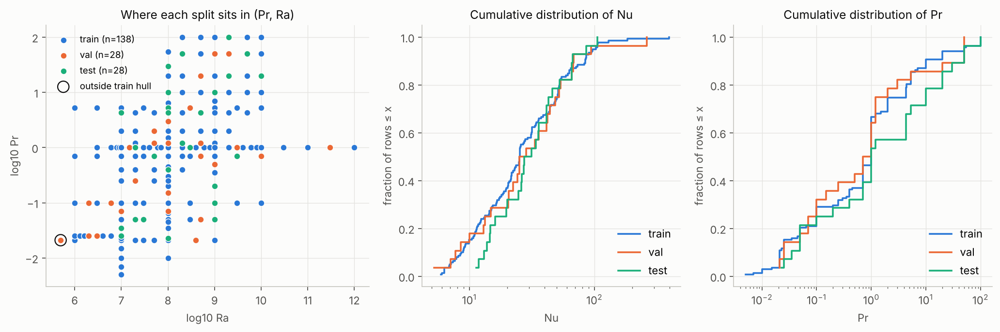
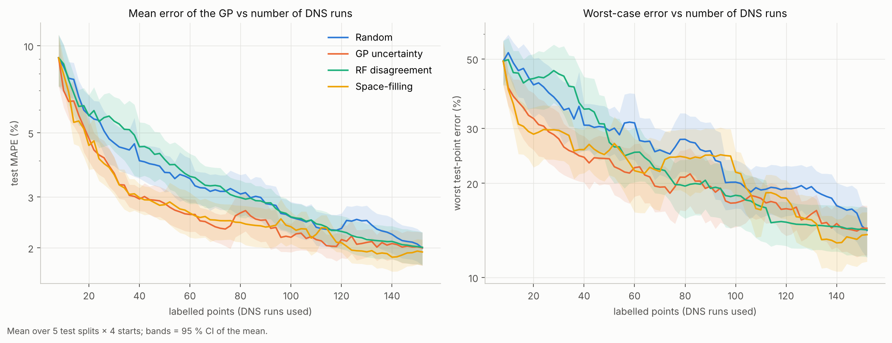
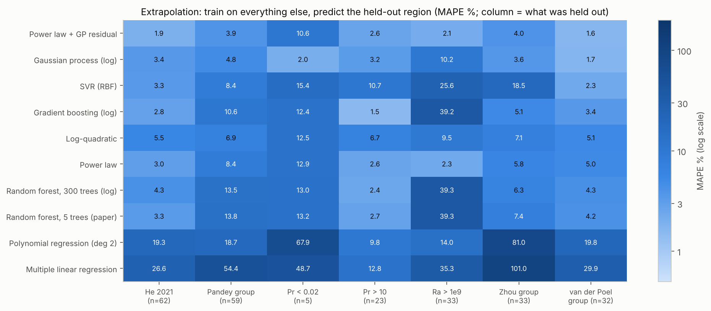
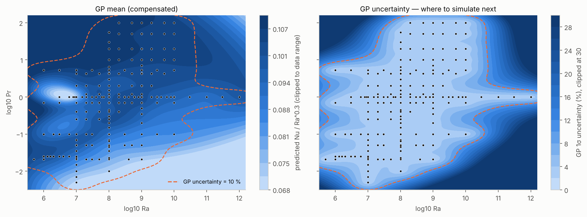
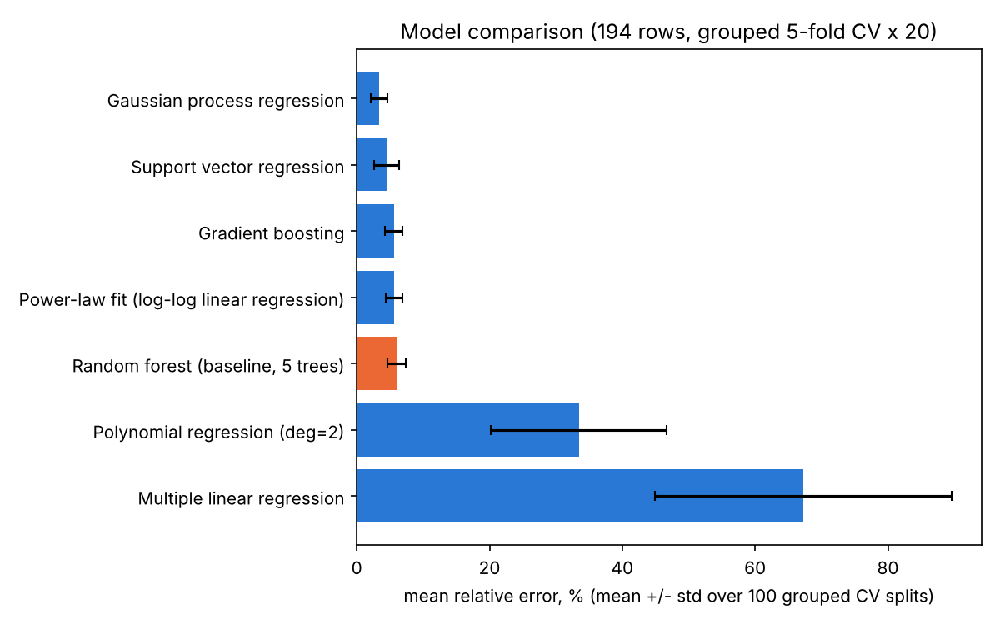

# rayleigh-benard

Machine-learning prediction of the Nusselt number (Nu) from Prandtl (Pr) and
Rayleigh (Ra) numbers in 2D Rayleigh-Bénard convection, following Sec. 3.3
("Forecasting heat transport using machine learning") of Shreshthi & Pandey's
paper, then extending it: a 3× larger dataset from 10 papers, grouped
validation, physics-informed and probabilistic models, learning curves,
active learning and extrapolation tests.

```
rayleigh-benard/
├── references.md                  # citation list, rows contributed per paper
├── data/
│   ├── nu_dataset_model.csv       # Pr, Ra, Nu only (194 rows). Load this for training.
│   └── nu_dataset_sources.csv     # same rows + Source, Grid, Notes, Flag
├── docs/
│   ├── data_sources.pdf           # full provenance: every source table reproduced,
│   │                              #   kept/excluded rows highlighted, cross-source
│   │                              #   agreement, flagged rows, extraction method
│   ├── data_sources.tex           # LaTeX source for the above
│   └── method_comparison.md       # results + discussion of the method comparison
├── papers/                        # open-access copies of source papers
├── notebooks/
│   ├── comprehensive_study.ipynb  # the full study, Kaggle-ready (clones this repo)
│   └── analysis.ipynb             # original EDA + the paper's random forest
├── scripts/
│   ├── baseline_random_forest.py  # standalone version of the paper's method
│   └── compare_models.py          # baseline vs. 6 other methods, grouped CV
└── results/                       # plots from the scripts; results/study/ from the notebook
```

## Data

**[`data/nu_dataset_model.csv`](data/nu_dataset_model.csv)**: 194 rows,
columns `Pr, Ra, Nu`, at 172 distinct (Pr, Ra) points.

| | min | max |
|---|---|---|
| Pr | 0.005 | 100 |
| Ra | 5×10⁵ | 10¹² |
| Nu | 5.2 | 394.2 |

Every row describes the same physical setup: a closed 2D square box (Γ = 1),
no-slip on all walls, isothermal top/bottom plates, adiabatic sidewalls.

| Source | Rows | How |
|---|---|---|
| Shreshthi & Pandey (2026), Pandey (2021), Pandey & Sreenivasan (2025), Pandey, Tiwari & Sreenivasan (2026) | 59 | tables |
| He et al. (2021) | 62 | extracted from the vector graphics of Fig. 5(a) |
| Zhang, Zhou & Sun (2017) | 18 | table |
| van der Poel, Stevens & Lohse (2013) | 16 | appendix table |
| van der Poel et al. (2012) | 16 | extracted from the vector graphics of Fig. 1(a) |
| Zhang & Zhou (2024) | 15 | table |
| Xu, Shi & Xi (2019) | 8 | table |

The sources use five different codes (spectral element, three
finite-difference codes, lattice Boltzmann). At the 20 points simulated by
more than one source, Nu agrees to a median of 1.5 %, which is the evidence
that the pooled data are homogeneous. Five rows are **flagged** in
`nu_dataset_sources.csv`, for example `Pr = 0.7, Ra = 10⁹`, where the 2D flow is
multistable and two papers report Nu = 49.2 and 53.5 (both physically
correct). Everything, row by row, is in
**[`docs/data_sources.pdf`](docs/data_sources.pdf)**.

Left out on purpose: resolution-check re-runs, exact cross-paper duplicates,
the periodic "RBC-P" configuration, other aspect ratios, and Yang et al. (2021),
whose values exist only in a low-resolution raster figure.

## Comprehensive study (Kaggle)

[`notebooks/comprehensive_study.ipynb`](notebooks/comprehensive_study.ipynb)
clones this repo and runs everything. On Kaggle: *File → Import notebook*
(paste the GitHub URL or upload the file), turn *Settings → Internet* on, then
*Run All*. It takes about 6–10 minutes on CPU. It covers:

1. Dataset ranges overall and per source, coverage maps, cross-source agreement.
2. A **grouped** 70/15/15 train/val/test split (no (Pr, Ra) point on both
   sides), with the Pr / Ra / Nu range of every split and which test points
   need extrapolation.
3. Ten methods tuned on validation and evaluated once on test.
4. Repeated grouped 5-fold CV (50 splits per method).
5. Learning curves.
6. Active learning curves: GP-uncertainty, tree-disagreement and
   space-filling query strategies vs. random, over 5 test splits × 4 starts.
7. Extrapolation tests: hold out Ra > 10⁹, Pr < 0.02, Pr > 10, or a whole
   code family.
8. The GP response surface Nu(Pr, Ra) with its uncertainty map.
9. Sensitivity to the flagged rows.

Ranges per split (grouped 70/15/15, seed 42):

| Split | Rows | Pr | Ra | Nu (median) | Inside training range |
|---|---|---|---|---|---|
| train | 138 | 0.005 – 100 | 10⁶ – 10¹² | 5.91 – 394.2 (25.2) | — |
| val | 28 | 0.021 – 50 | 5×10⁵ – 3×10¹¹ | 5.2 – 262.3 (26.8) | 96 % |
| test | 28 | 0.023 – 100 | 10⁷ – 10¹⁰ | 11.4 – 105.9 (29.4) | 100 % |
| all | 194 | 0.005 – 100 | 5×10⁵ – 10¹² | 5.2 – 394.2 (25.3) | |

Every test point lies inside the training data's convex hull, so the
single-split test score is an *interpolation* score and comes out
optimistic. The grouped CV and the extrapolation tests are the numbers to
quote.

Key results (grouped CV, mean relative error):

| Method | MAPE % |
|---|---|
| **Power law + GP residual** (physics mean + GP correction) | **1.8** |
| Gaussian process on log Nu | 1.9 |
| SVR | 3.9 |
| Gradient boosting (log target) | 4.4 |
| Power law `Nu = 0.0999·Ra^0.298·Pr^0.031` | 5.6 |
| Random forest, 5 trees (**paper's method**) | 6.0 |

**Active learning:** choosing the next simulation where the GP is most
uncertain, or where the (Pr, Ra) plane is emptiest, reaches 3 % mean error
with a median of 32–37 DNS runs, against 50 picked at random. It brings the
worst test-point error under 15 % with about 45 runs, against 89 at random,
so roughly half the simulations. Choosing by random-forest tree disagreement
is no better than random. Medians are over 5 test splits × 4 starts.

Extrapolation is where models separate. Trained on Ra ≤ 10⁹ and asked for
Ra > 10⁹, the random forests miss by 39 %, while the power law and power law +
GP stay near 2 %. Trained without Pr < 0.02, the plain log-GP extrapolates best
(2 %).









## Method comparison script

`scripts/compare_models.py` checks the paper's random forest against 6 other
methods with repeated **grouped** 5-fold CV (100 splits per method):

| Method | MAPE % | std | mean R² |
|---|---|---|---|
| Gaussian process regression | **3.39** | 1.29 | 0.996 |
| Support vector regression | 4.52 | 1.85 | 0.919 |
| Gradient boosting | 5.57 | 1.36 | 0.923 |
| Power-law fit | 5.61 | 1.26 | **0.996** |
| Random forest (paper's method, 5 trees) | 5.97 | 1.37 | 0.923 |
| Polynomial regression (deg 2) | 33.4 | 13.3 | 0.896 |
| Multiple linear regression | 67.3 | 22.3 | 0.642 |

With 59 rows the random forest's error was 12.4 %; with 194 rows it is 6.0 %.
The single 70/30 split the paper uses gives R² = 0.973 (`analysis.ipynb`,
`baseline_random_forest.py`). That number is optimistic, because rows of the
same (Pr, Ra) can land in train and test. Why the random forest fails above
Ra = 10¹⁰, and the full reasoning per method, are in
**[`docs/method_comparison.md`](docs/method_comparison.md)**.



