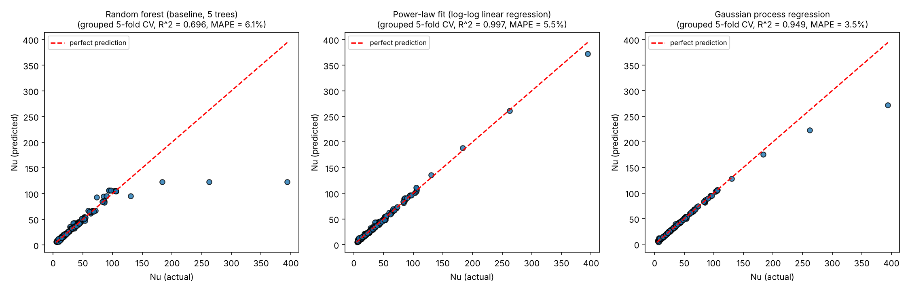

# Method comparison: what to try beyond the paper's random forest

The paper's Sec. 3.3 says it tried multiple linear regression, polynomial
regression, and support vector regression before settling on a random forest
(5 trees, 70/30 split, R² = 0.98 on their 55-point set). `scripts/compare_models.py`
runs all three of those plus the random forest baseline and three suggested
alternatives on the expanded **194-row** dataset (172 distinct (Pr, Ra)
points, 10 papers).

Two changes from the 59-row version of this comparison:

- **Grouped cross-validation.** 20 (Pr, Ra) points are reported by more than
  one paper. Plain k-fold could put one paper's run in train and another
  paper's run of the *same* point in test, which leaks information. Folds are
  now grouped by (Pr, Ra), 5-fold × 20 reshuffles = 100 splits per method.
- **Mean relative error (MAPE) as the headline metric.** Nu spans 5 to 394.
  R² is dominated by the handful of Ra ≥ 10¹¹ points and can hide 10 %
  errors everywhere else, so methods are ranked by MAPE, with R² alongside.

For the much fuller study (grouped train/val/test with ranges per split,
hyperparameter tuning, learning curves, active learning curves, extrapolation
tests, GP response surface) see `notebooks/comprehensive_study.ipynb`.

## Results (194 rows, grouped 5-fold CV × 20 repeats = 100 splits)

| Method | MAPE % | std | mean R² | std |
|---|---|---|---|---|
| Gaussian process regression | **3.39** | 1.29 | 0.996 | 0.011 |
| Support vector regression | 4.52 | 1.85 | 0.919 | 0.144 |
| Gradient boosting | 5.57 | 1.36 | 0.923 | 0.078 |
| Power-law fit `Nu = 0.0999·Ra^0.298·Pr^0.031` | 5.61 | 1.26 | **0.996** | **0.003** |
| Random forest (baseline, 5 trees) | 5.97 | 1.37 | 0.923 | 0.102 |
| Polynomial regression (deg 2) | 33.4 | 13.3 | 0.896 | 0.054 |
| Multiple linear regression | 67.3 | 22.3 | 0.642 | 0.139 |

With 59 rows the random forest's error was 12.4 %; with 194 it is 6.0 %. The
GP went from 5.4 % to 3.4 %. Every flexible method improved because the
Ra = 10⁸–10¹⁰ region is now densely sampled.

## What the table hides: `results/top_methods_predicted_vs_actual.png`

The three panels differ only at the top end. Above Ra = 10¹⁰ the dataset has
only the Pr = 1 series of Pandey & Sreenivasan (2025), so predicting those
points is **extrapolation in Ra**:

- **Random forest:** flat at Nu ≈ 120 for all three highest points. Trees
  average leaf values and cannot predict beyond what they saw.
- **Gaussian process (raw-Nu target):** better, but sags back toward the
  mean (Nu = 272 instead of 394). An RBF-kernel GP reverts to its prior mean
  far from data.
- **Power law:** tracks them, because a power law *is* the right
  extrapolating shape. That is why its R² is the best and most stable even
  though its MAPE is mid-table: in the dense region a single global power law
  is too rigid (Nu's Pr-dependence flattens above Pr ≈ 1), and in the sparse
  high-Ra region it is the only model that extrapolates.

The notebook resolves this tension with two models not in this script: a GP
on **log Nu** (which extrapolates as a local power law) and a **power-law
mean + GP residual** model, which keeps the power law's extrapolation and
lets the GP fix the Pr-curvature. Both beat everything here on grouped CV:
1.8 % and 1.9 % MAPE (worst single point about 11–14 %), against 3.4 % for
the raw-target GP and 6.0 % for the paper's random forest.

## Why these methods specifically

**Gaussian process regression.** It is one of the few methods that reports
how confident it is in each prediction. That makes it the natural engine for
*active learning*: deciding which new (Pr, Ra) is worth simulating next. The
notebook's Section 7 tests exactly that.

**Power-law fit.** Heat transport in convection follows power laws (the paper
itself fits Nu ~ Pr^0.08 in Fig. 3), so `Nu = C·Ra^a·Pr^b` is the most
physically natural model, and it hands you two exponents you can compare
with the literature. The fitted Ra exponent, 0.298, sits next to the
Nu ~ Ra^0.3 scaling usual for 2D convection at these Ra.

**Gradient boosting.** The natural next tree ensemble. It now matches the
power law on MAPE, which it did not on 59 rows: tree ensembles needed more
data. It still cannot extrapolate in Ra.

## Caveats

- An irreducible scatter floor of roughly 1–3 % comes from 2D flow-state
  multistability: at some (Pr, Ra) the same simulation can settle into
  different roll states with different Nu (van der Poel et al. 2012, 2013).
  The flagged rows in `data/nu_dataset_sources.csv` are the clearest cases.
- The script uses untuned hyperparameters. The notebook tunes them on a
  validation split.
- `notebooks/analysis.ipynb` and `scripts/baseline_random_forest.py` keep the
  paper's single random 70/30 split (now R² = 0.973) for comparison with the
  paper. That number is optimistic for the reasons above.
